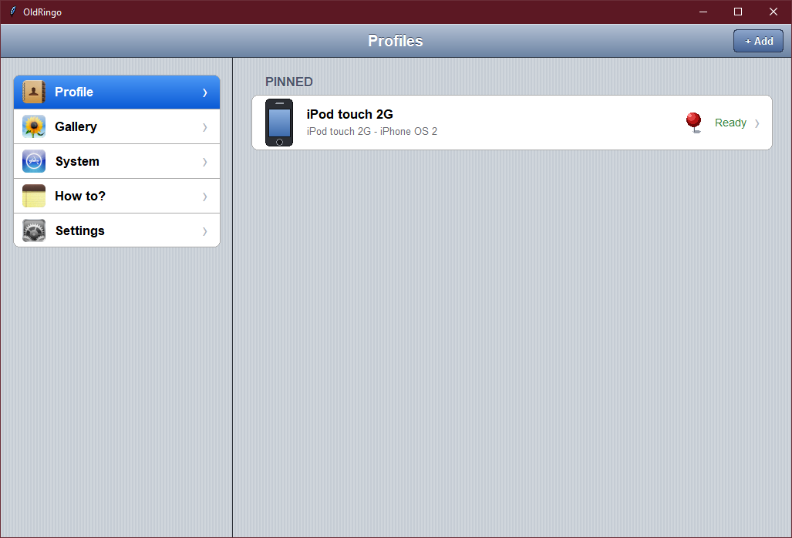
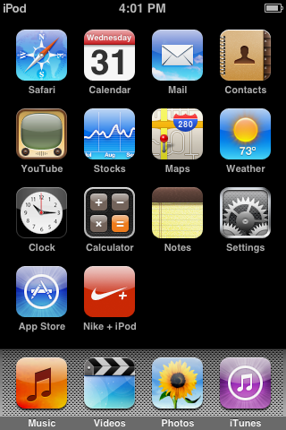

# OldRingo

A simple Windows launcher for running **iPod touch 1st / 2nd generation** virtual machines with [qemu-ios](https://github.com/devos50/qemu-ios). It sets up the build environment, compiles the emulator, downloads firmware and lets you manage VM profiles from an iPad-style interface.

<p align="center">
  
  
</p>

> **Disclaimer:** OldRingo is an independent project. It is not affiliated with, authorized by, sponsored by, or endorsed by Apple Inc. It does not bundle any Apple software.

## Features

- **One-click setup:** installs MSYS2 and every package needed to build the emulator.
- **Hardware manager:** downloads and compiles qemu-ios for iPod touch 1G / 2G.
- **Firmware manager:** downloads firmware or lets you use your own files.
- **Profiles:** save a name, hardware, firmware and memory size, then run the VM in one tap.
- **Gallery:** screenshots taken from the VM are saved and browsable inside the app.
- **Assistive Touch:** a floating button next to the VM window for Home, Power, Screenshot and quick media control. Single, double and triple taps can be customized.
- **Keyboard shortcuts:** global screenshot shortcut, `H` for Home, and an option to block the `P` key.
- **Mirror support:** extra MSYS2 mirrors to avoid slow or blocked downloads.
- **Logs and diagnostics:** live logs and optional session log saving.

## Requirements

- Windows 10 / 11 (64-bit)
- Python 3 with Tcl/Tk (no extra pip packages needed)
- A stable internet connection and about 30-90 minutes for the first build
- Free disk space on `C:` (the launcher uses `C:\qemu-ios` and `C:\msys64`)

## Getting started

```bash
python app.py
```

You can also double-click `run.bat`.

1. **Set up the environment:** open *System > Requirements* and tap **Set Up**.

   > **About `MSYS2.exe.txt`:** the MSYS2 installer is too large for GitHub, so this repo only contains a placeholder file named `MSYS2.exe.txt`. Download the real installer (`msys2-x64-*.exe`) from [msys2.org](https://www.msys2.org), delete the placeholder, and save the installer as `msys2.exe` next to `app.py`. If no local installer is found, the launcher tries to download it automatically.

2. **Install hardware:** open *System > Hardware*, tap the `•••` button next to a device and choose **Install**.
3. **Download firmware:** tap `•••` next to a firmware and choose **Download** (or use *Custom firmware* when creating a profile).
4. **Create a profile:** go to *Profile > + Add*, choose name, hardware, firmware and memory, then **Save**.
5. **Run:** open the profile and tap **Run**.

## Controls inside the VM

| Input | Action |
| --- | --- |
| Mouse | Acts as your finger (click = tap, drag = swipe) |
| `H` | Home button |
| `P` | Power button (see the warning below) |
| Floating button | Drag to move, tap for Home / Power / Screenshot / Media |

> **Warning:** pressing `P` currently makes the VM panic because the emulation of the hardware is still incomplete. Avoid it for now, or enable the option to block the `P` key in *Settings > Keyboard*.

## Project structure

| File | Purpose |
| --- | --- |
| `app.py` | Main window and all pages |
| `core.py` | Core logic (setup, build, firmware, profiles), no GUI |
| `kit.py` | Custom tkinter UI components |
| `assist.py` | Floating Assistive Touch button |
| `keys.py` | Global keyboard hook (Windows only) |
| `imgkit.py`, `icons_data.py` | Image and icon generation |
| `legal_text.py` | License text shown on the Legal page |
| `MSYS2.exe.txt` | Placeholder only. Replace it with the real MSYS2 installer (see above) |

## Author

OldRingo is developed by **Mắt Thần Team**, the umbrella brand of **Phúc Power** ([@PhucPower300121](https://github.com/PhucPower300121)), who is currently the only member: developer, designer, tester and maintainer.

## Contributing

Contributions are very welcome. Feel free to fork the project, fix bugs, add features, improve the UI, support more devices or translate the app. Pull requests and issues are both appreciated.

> **Please note:** the maintainer is a solo developer who rarely updates or checks GitHub, so replies and merges can take a long time. Don't be discouraged: you are encouraged to keep your own fork going and to extend the project freely under the GPLv3 license.

## Acknowledgements

- [qemu-ios](https://github.com/devos50/qemu-ios) by Martijn de Vos (devos50) - the emulator that makes this possible.
- [QEMU](https://www.qemu.org) and the [MSYS2](https://www.msys2.org) project.
- Apple Inc. for creating iPhone OS / iOS for the iPod touch. iPod touch and iOS are trademarks of Apple Inc.

## License

OldRingo is free software released under the **GNU General Public License v3.0**. The full text is available on the *Settings > About > Legal* page. The software is provided "as is", without warranty of any kind. Use it at your own risk.
